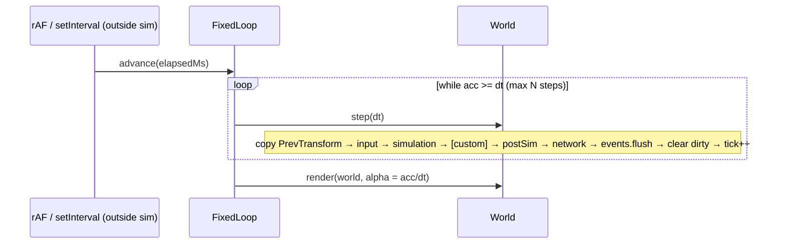

# Engine Architecture

2.5D isometric, multiplayer co-op survival engine (gathering, building, combat, day/night, weather). Browser first; cross-platform later.
Status: v0 skeleton. See `DECISIONS.md` for the ADR log. Netcode detail: `packages/net/ARCHITECTURE.md`.

## 1. High-level

```mermaid
flowchart LR
  subgraph Client [apps/client - browser, Vite]
    CI[Input devices] --> IS[InputState]
    IS --> CS[World sim - predicted]
    CS --> RP[renderPrep] --> R[@engine/render WebGL2]
    CN[@engine/net client] <--> CS
  end
  subgraph Server [apps/server - Node headless]
    SN[@engine/net server] <--> SS[World sim - authoritative]
  end
  CN <-- WebSocket binary / later WebTransport --> SN
  CS -.same packages.- SS
```

```mermaid
flowchart TB
  core[@engine/core\nECS, loop, math, events, schema, serialization, rng, input, assets]
  world[@engine/world\nchunks, tiles, iso coords, spatial hash]
  render[@engine/render\nstub - Renderer team]
  net[@engine/net\nstub - Netcode team]
  gameplay[@engine/gameplay\nstub - Survival Systems team]
  client[apps/client] --> render & net & gameplay & world & core
  server[apps/server] --> net & gameplay & world & core
  render --> world & core
  gameplay --> world & core
  net --> core
  world --> core
```

Rule: **dependencies point toward core**. `core`/`world`/`gameplay` must not touch DOM, WebGL, sockets or wall clock, so they run unchanged in Node.

## 2. Tech stack

| Choice | Rationale |
|---|---|
| TypeScript strict (+`noUncheckedIndexedAccess`, `exactOptionalPropertyTypes`) | One language for client + server sim; strictness catches the typed-array index bugs ECS code is prone to. |
| pnpm workspaces | Fast, strict dependency isolation (no phantom deps), `workspace:*` links. |
| Source-first packages (`main: src/index.ts`) | No per-package build step in dev; Vite, Vitest and tsx consume TS directly. `build` = typecheck; bundling only in apps. |
| Vite (client) | Instant HMR, native TS/ESM, good WebGL/asset story. |
| Vitest | Same transform pipeline as Vite, fast, Jest-compatible API. |
| Node 20 + tsx (server) | Runs the identical sim packages headless. |
| WebGL2 thin custom layer | Wide browser support, sprite batching control for iso depth sorting; WebGPU can be added behind `Renderer`. |

## 3. Package ownership

| Package | Owner | Status |
|---|---|---|
| `packages/core` | Engine/Architecture | Implemented |
| `packages/world` | Engine/Architecture | Implemented |
| `packages/render` | 2.5D Renderer team | Interfaces + `NullRenderer` |
| `packages/net` | Netcode team | Interfaces + message schemas; design in its ARCHITECTURE.md |
| `packages/gameplay` | Survival Systems team | Stub (Health, ResourceNode, day/night system) |
| `apps/client`, `apps/server` | Engine (shared) | Bootstraps |

Cross-team changes to `core` public API go through an ADR.

## 4. ECS design

- **Entity** = `uint32`: low 20 bits index (≤1,048,576), high 12 bits generation. Stale handles fail `isAlive`. Indices recycled via free list. Local entity ids are never sent on the wire (use `NetId`).
- **Components** = plain numeric data declared with a schema: `defineComponent(name, { x: "f32", hp: { type: "u16", quant: {bits, min, max} } }, { networked: true })`. No strings, objects or references; ids are numeric (tile ids, item ids, enum values).
- **Storage**: one sparse-set per component: `sparse: Int32Array[maxEntities]` → dense slot; SoA typed arrays per field (`store.data.x[slot]`); swap-remove. No archetypes → O(1) add/remove, no table migration.
- **Component ids** = registration order on the `World`. Built-ins register first: `NetId=0, Owner=1, Transform=2, PrevTransform=3`; gameplay registers next via one shared module on client and server. `world.getSchemaHash()` (FNV-1a over id, name, networked flag, field signature incl. quant hints) is checked at handshake and in snapshots.
- **Built-ins**: `NetId {id:u32}`, `Owner {clientId:u16}` (networked); `Transform {x,y,z,facing:f32}` in float tile units (networked); `PrevTransform` (local) copied from Transform at the **start** of each tick for interpolation.
- **Queries**: `world.query(all, none?)` iterates from the smallest store; iteration runs backwards so destroying the current entity is safe. Hot systems may read `store.data` arrays directly.
- **Change tracking**: each store has a per-entity dirty bitset set by `add`, `set`, `setField`, `store.write` and explicit `store.markChanged(i)` (required after raw typed-array writes). `world.changed(def)` iterates; cleared at end of `step()`.
- **Hooks**: `onSpawn`, `onDespawn` (despawn fires before components are removed).
- **Resources**: typed global singletons (`TimeOfDay`, `Weather`, ...) via `defineResource<T>(name)` + `world.setResource/resource`.
- **Events**: `EventBus` queued per tick (`emit` → delivered at `flush` at end of tick, deterministic order) plus `emitNow`.

## 5. Loop design



- Default **20 Hz** (`DEFAULT_TICK_HZ`), configurable. Accumulator with spiral-of-death clamp (`maxStepsPerFrame`, backlog dropped).
- Time is **injected**: only apps read `performance.now()`. Sim uses `world.tick`, `dt`, and `world.rng` (mulberry32, single u32 state → snapshot-able). No `Date.now`/`Math.random` in sim packages.
- Phases: `input, simulation, postSim, network, renderPrep`; custom phases via `addPhase(name, {after})`. `renderPrep` runs only on client per frame.
- `world.simulate(n, dt, beforeTick?)` runs only the simulation phase n times — used by prediction reconciliation.

## 6. Data & serialization rules (networking)

1. Wire data comes only from component schemas / message schemas. Little-endian. Fields encoded in **sorted name order** (declaration order irrelevant).
2. Only `networked: true` components replicate. Sim-local components (PrevTransform, caches) never do.
3. Quantization is **wire-only**: `quant {bits,min,max}` hints live on the schema; `wireValue/quantize/dequantize` are used by net when sending. Sim state keeps full precision.
4. Per-field codecs `encodeField/decodeField(store, field, slot, FieldWriter|FieldReader)` — net wraps a bit writer around them.
5. Every blob is versioned: snapshot header `magic, version, tick, worldSchemaHash`; per component `id, schemaHash`. Decoders reject newer versions and hash mismatches. Schema changes ⇒ bump version / hash changes ⇒ clients must update.
6. Entity references across the wire use `NetId`, never local entity ids.
7. Inputs are serializable `InputFrame {tick, buttons bitfield, aim}`; the server applies them in the `input` phase.

## 7. World

- Chunks: 32×32 tiles, `Uint16Array` tile ids (0 = empty) + `Uint8Array` height, `dirty`/`version` for render & net streaming. `TileMap` stores chunks in a `Map<packedKey,Chunk>`, supports negative coords.
- Iso: 2:1 dimetric (64×32 px tiles, 16 px per z), `worldToScreen`, `screenToWorld(z)`, `screenToTile`, `isoDepth`.
- `SpatialHash` uniform grid (default 4 tiles) for broad-phase proximity/interest.

## 8. Coding conventions

- Strict TS, ESM only, `.js` suffix in relative imports, `import type` for types (`verbatimModuleSyntax`).
- Sim packages: no DOM, no I/O, no wall clock, no `Math.random`; allocations avoided in per-entity hot loops.
- Components: numbers only; enums as `const enum` numeric; units are tile units / seconds / radians.
- Systems: `(world, dt) => void`, named, registered in phases; no hidden ordering.
- Tests: `packages/*/test/*.test.ts`, Vitest; each package's public behaviour tested. `pnpm test`, `pnpm -r build` (typecheck + client bundle) must pass before merge.
- Public API changes in core ⇒ ADR in `docs/DECISIONS.md`.

## 9. Open questions

1. Entity limit per world (default 65,536; max 2^20) and memory per store (`sparse` is `Int32Array[maxEntities]` per component) — move to paged sparse arrays if component count grows?
2. Floating-point determinism across browsers/Node: rely on reconciliation, or move sim to fixed-point for lockstep features?
3. Change tracking granularity: per-entity bits now; does net need per-field bits?
4. Removed-component tracking (component removed but entity alive) for delta replication.
5. Chunk streaming/persistence format and server-side save games (reuse snapshot format?).
6. Renderer in a Worker with OffscreenCanvas?
7. WebTransport timing and unreliable channel semantics.
8. Scripting/modding layer, and asset pipeline (atlas packing, hot reload).
