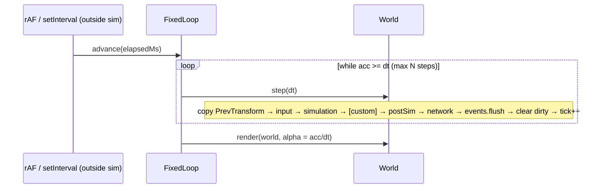
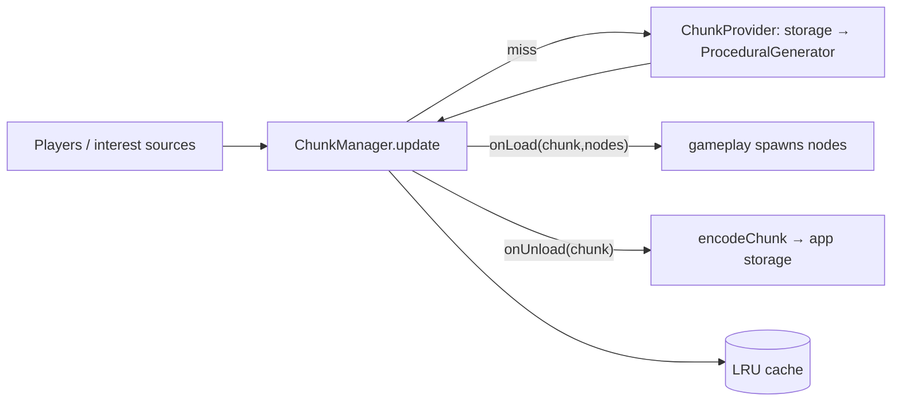
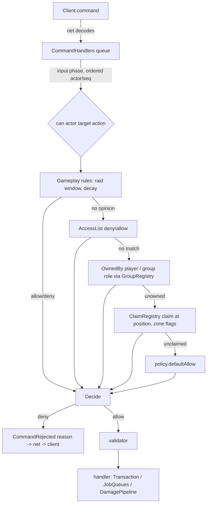
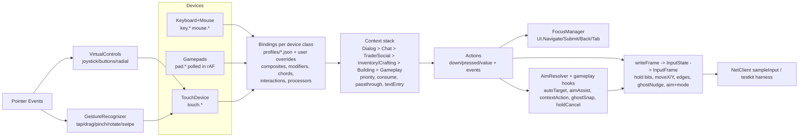
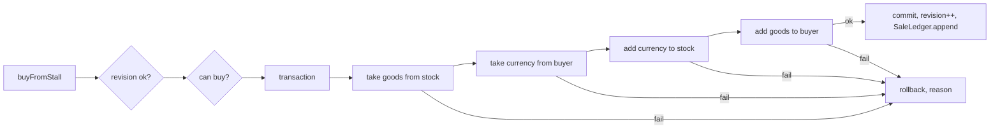

# Engine Architecture

2.5D isometric, multiplayer co-op survival engine (gathering, building, combat, day/night, weather). Browser first; cross-platform later.
Status: v0 skeleton. See `DECISIONS.md` for the ADR log. Netcode detail: `packages/net/ARCHITECTURE.md`.

## 1. High-level

```mermaid
flowchart LR
  subgraph Client [apps/client - browser, Vite]
    CI[Input devices] --> IS[InputState]
    IS --> CS[World sim - predicted]
    CS --> RP[renderPrep] --> R[@engine/render WebGL2]
    CN[@engine/net client] <--> CS
  end
  subgraph Server [apps/server - Node headless]
    SN[@engine/net server] <--> SS[World sim - authoritative]
  end
  CN <-- WebSocket binary / later WebTransport --> SN
  CS -.same packages.- SS
```

```mermaid
flowchart TB
  core[@engine/core\nECS, loop, math, events, schema, serialization, rng, input, assets]
  world[@engine/world\nchunks, tiles, iso coords, spatial hash]
  render[@engine/render\nstub - Renderer team]
  net[@engine/net\nstub - Netcode team]
  gameplay[@engine/gameplay\nstub - Survival Systems team]
  client[apps/client] --> render & net & gameplay & world & core
  server[apps/server] --> net & gameplay & world & core
  render --> world & core
  gameplay --> world & core
  net --> core
  world --> core
```

Rule: **dependencies point toward core**. `core`/`world`/`gameplay` must not touch DOM, WebGL, sockets or wall clock, so they run unchanged in Node.

## 2. Tech stack

| Choice | Rationale |
|---|---|
| TypeScript strict (+`noUncheckedIndexedAccess`, `exactOptionalPropertyTypes`) | One language for client + server sim; strictness catches the typed-array index bugs ECS code is prone to. |
| pnpm workspaces | Fast, strict dependency isolation (no phantom deps), `workspace:*` links. |
| Source-first packages (`main: src/index.ts`) | No per-package build step in dev; Vite, Vitest and tsx consume TS directly. `build` = typecheck; bundling only in apps. |
| Vite (client) | Instant HMR, native TS/ESM, good WebGL/asset story. |
| Vitest | Same transform pipeline as Vite, fast, Jest-compatible API. |
| Node 20 + tsx (server) | Runs the identical sim packages headless. |
| WebGL2 thin custom layer | Wide browser support, sprite batching control for iso depth sorting; WebGPU can be added behind `Renderer`. |

## 3. Package ownership

| Package | Owner | Status |
|---|---|---|
| `packages/core` | Engine/Architecture | Implemented |
| `packages/world` | Engine/Architecture | Implemented |
| `packages/render` | 2.5D Renderer team | Interfaces + `NullRenderer` |
| `packages/net` | Netcode team | Interfaces + message schemas; design in its ARCHITECTURE.md |
| `packages/assets` | Engine/Architecture (format), Art/Renderer (content) | Manifest loader, registry, placeholder art |
| `packages/testkit` | Engine/Architecture | Headless multi-client harness |
| `packages/gameplay` | Survival Systems team | Stub (Health, ResourceNode, day/night system) |
| `apps/client`, `apps/server` | Engine (shared) | Bootstraps |

Cross-team changes to `core` public API go through an ADR.

## 4. ECS design

- **Entity** = `uint32`: low 20 bits index (≤1,048,576), high 12 bits generation. Stale handles fail `isAlive`. Indices recycled via free list. Local entity ids are never sent on the wire (use `NetId`).
- **Components** = plain numeric data declared with a schema: `defineComponent(name, { x: "f32", hp: { type: "u16", quant: {bits, min, max} } }, { networked: true })`. No strings, objects or references; ids are numeric (tile ids, item ids, enum values).
- **Storage**: one sparse-set per component: `sparse: Int32Array[maxEntities]` → dense slot; SoA typed arrays per field (`store.data.x[slot]`); swap-remove. No archetypes → O(1) add/remove, no table migration.
- **Component ids** = registration order on the `World`. Built-ins register first: `NetId=0, Owner=1, Transform=2, PrevTransform=3`; gameplay registers next via one shared module on client and server. `world.getSchemaHash()` (FNV-1a over id, name, networked flag, field signature incl. quant hints) is checked at handshake and in snapshots.
- **Built-ins**: `NetId {id:u32}`, `Owner {clientId:u16}` (networked); `Transform {x,y,z,facing:f32}` in float tile units (networked, persistent; wire quantization z q10 [0,64], facing q8 [-π,π] — keep facing normalized); `PrevTransform` (local) copied from Transform at the **start** of each tick for interpolation.
- **Queries**: `world.query(all, none?)` iterates from the smallest store; iteration runs backwards so destroying the current entity is safe. Hot systems may read `store.data` arrays directly.
- **Change tracking**: each store has a per-entity dirty bitset set by `add`, `set`, `setField`, `store.write` and explicit `store.markChanged(i)` (required after raw typed-array writes). `world.changed(def)` iterates; cleared at end of `step()`.
- **Removal tracking**: each store records entities (with generation at removal) that lost the component this tick via `remove`/`destroy`; `world.removed(def)`. Same-tick re-add shows in both `removed` and `changed`. Cleared with dirty bits; untouched by `simulate()`.
- **Array fields & defaults**: `{type, length}` (stride-n SoA, `getArray/getElement/setElement`) and `{type, default}` (applied on add). Both are in the schema hash.
- **Environment**: `world.environment` singleton (NetId=ENV_NET_ID=1) with networked `TimeOfDay {dayLengthTicks, epochTick}` and `Weather {kind, intensity, endsAtTick}` (kind = gameplay u8 id). Neither changes per tick: read time with `timeOfDay(world)` (hours 0-24, day, derived from `world.tick`), jump with `setTimeOfDay`/`setDayLength`; weather lasts while `tick < endsAtTick`.
- **RNG streams**: `world.rngFor(key, netIdOrEntity?)` deterministic per (seed, tick, key, entity) for predictable outcomes; `world.rng` stays for authority-only rolls.
- **Input**: `defineActions` bit masks + schema commands (`defineCommand`, `CommandRegistry`, `encodeInputFrame`).
- **Spatial index**: `installSpatialIndex(world)` (world pkg) → postSim system `spatialIndex`, resource `SpatialIndexRes`.
- **Hooks**: `onSpawn`, `onDespawn` (despawn fires before components are removed).
- **Resources**: typed global singletons (`TimeOfDay`, `Weather`, ...) via `defineResource<T>(name)` + `world.setResource/resource`.
- **Events**: `EventBus` queued per tick (`emit` → delivered at `flush` at end of tick, deterministic order) plus `emitNow`.

## 5. Loop design



- Default **20 Hz** (`DEFAULT_TICK_HZ`), configurable. Accumulator with spiral-of-death clamp (`maxStepsPerFrame`, backlog dropped).
- Time is **injected**: only apps read `performance.now()`. Sim uses `world.tick`, `dt`, and `world.rng` (mulberry32, single u32 state → snapshot-able). No `Date.now`/`Math.random` in sim packages.
- Phases: `input, simulation, postSim, network, renderPrep`; custom phases via `addPhase(name, {after})`. `renderPrep` runs only on client per frame.
- `world.simulate(n, dt, {systems, beforeTick, startTick, keepEvents})` replays only the simulation phase (optionally named systems) with `world.tick` set per replayed tick and `isReplaying` true; events discarded by default; `world.predicted` marks predicted entities. `world.systemOrder()` lists order.

## 6. Data & serialization rules (networking)

1. Wire data comes only from component schemas / message schemas. Little-endian. Fields encoded in **sorted name order** (declaration order irrelevant).
2. Only `networked: true` components replicate. Sim-local components (PrevTransform, caches) never do.
3. Quantization is **wire-only**: `quant {bits,min,max}` hints live on the schema; `wireValue/quantize/dequantize` are used by net when sending. Sim state keeps full precision.
4. Per-field codecs `encodeField/decodeField(store, field, slot, FieldWriter|FieldReader)` — net wraps a bit writer around them.
5. Every blob is versioned: snapshot header `magic, version, tick, worldSchemaHash`; per component `id, schemaHash`. Decoders reject newer versions and hash mismatches. Schema changes ⇒ bump version / hash changes ⇒ clients must update.
6. Entity references across the wire use `NetId`, never local entity ids.
7. Inputs are serializable `InputFrame {tick, buttons bitfield, aim}`; the server applies them in the `input` phase.

## 7. World

- Chunks: 32×32 tiles, `Uint16Array` tile ids (0 = empty) + `Uint8Array` height, `dirty`/`version` for render & net streaming. `TileMap` stores chunks in a `Map<packedKey,Chunk>`, supports negative coords.
- Iso: 2:1 dimetric (64×32 px tiles, 16 px per z), `worldToScreen`, `screenToWorld(z)`, `screenToTile`, `isoDepth`.
- `SpatialHash` uniform grid (default 4 tiles) for broad-phase proximity/interest.

**Height convention (iso):** 1 terrain level = `zStep` = 16 px; 1 building floor = `FLOOR_HEIGHT_LEVELS` = 3 terrain levels (walls are 48 px tall; roofs of floor f sit at terrain level (f+1)·3 above the base). `Transform.z` is in terrain levels; `BuildingGrid` z is a floor index — convert with `floorToTerrainZ(floor, baseZ)` / `terrainZToFloor(z, baseZ)`.

## 8. Coding conventions

- Strict TS, ESM only, `.js` suffix in relative imports, `import type` for types (`verbatimModuleSyntax`).
- Sim packages: no DOM, no I/O, no wall clock, no `Math.random`; allocations avoided in per-entity hot loops.
- Components: numbers only; enums as `const enum` numeric; units are tile units / seconds / radians.
- Systems: `(world, dt) => void`, named, registered in phases; no hidden ordering.
- Tests: `packages/*/test/*.test.ts`, Vitest; each package's public behaviour tested. `pnpm test`, `pnpm -r build` (typecheck + client bundle) must pass before merge.
- Public API changes in core ⇒ ADR in `docs/DECISIONS.md`.

## 9. Open questions

1. Entity limit per world (default 65,536; max 2^20) and memory per store (`sparse` is `Int32Array[maxEntities]` per component) — move to paged sparse arrays if component count grows?
2. Floating-point determinism across browsers/Node: rely on reconciliation, or move sim to fixed-point for lockstep features?
3. Change tracking granularity: per-component bits (arrays included); per-field/element bits requested by gameplay E1/net N8 — still open.
4. ~~Removed-component tracking for delta replication~~ — resolved by ADR-023 (`world.removed(def)`). Remaining: does net need removal history beyond one tick (it must accumulate per-client between acks itself)?
5. ~~Chunk streaming/persistence format~~ — ADR-034/035. Open: storage backend, save-game index, async providers (worker generation).
6. Renderer in a Worker with OffscreenCanvas?
7. WebTransport timing and unreliable channel semantics.
8. Scripting/modding layer, and asset pipeline (atlas packing, hot reload).

## 10. World Streaming

- **Coordinates**: chunks are 32×32 tiles with signed int32 chunk coords; `ChunkKey = "cx,cy"`; helpers `chunkKey`, `parseChunkKey`, `chunkOf(pos)`, `chunkKeyOf(x,y)`.
- **ChunkManager** (extends `TileMap`): interest sources (`setSource({id,x,y,radius?})`) → active set (Chebyshev radius `loadRadius`), `unloadMargin` hysteresis, `maxLoadsPerUpdate` streaming budget, LRU (`cacheSize`) of inactive chunks. Hooks (stable names): `onLoad(chunk, nodes)`, `onUnload(chunk)`.
- **Providers**: `ChunkProvider.load(cx,cy)` returns `{chunk, nodes}`; `ProceduralGenerator({seed})` is the seeded stub (value-noise biomes + resource-node placements → gameplay spawns ResourceNodes in `onLoad`). A storage-backed provider decodes saved bytes first and falls back to the generator.
- **Persistence**: components flagged `persistent` are saved with their chunk via `encodeChunk(chunk, {world, entities, buildings})` / `decodeChunk(bytes, {world, buildings})` (versioned, RLE tiles, schema-hash checked, chunk-relative positions). No storage backend in engine packages.
- **Membership**: `ChunkMembership` (postSim) keeps entity→chunk; used by interest and per-chunk save.
- **Float precision**: f32 tile units are exact to 1/256 tile within ±65,536 tiles (`F32_SAFE_TILE_RANGE`). Beyond that use `WorldOrigin` rebasing (server regions, client camera) and chunk-relative storage. Never store absolute positions in f32 outside that range.



## 11. Interest Management

- `InterestGrid(membership, {radius, hysteresis})`; `setClientViewpoints(id, [{x, y, r?}])` (relevant set = union of viewpoints) or the shorthand `setClient(id, x, y, radius?)`, `setAlwaysRelevant(id, entities)`, `update()`, `get(id)` → `{chunks, entities, enteredChunks, leftChunks, entered, left}`.
- Cost per tick: O(clients × (2r+1)²) chunk checks + O(nearby entities); membership updates are O(moved entities).
- Benchmark (in `packages/world/test/interest.test.ts`, box CPU): 200 players, 50k entities over 64×64 chunks, r=2: initial membership 50k ≈ 20 ms, first interest update ≈ 14 ms, steady tick (2.5k moved entities + interest for 200 players) ≈ 8 ms, ~300 relevant entities/player.
- Netcode consumes enter/leave for spawn/despawn replication and budget prioritisation.

## 12. Building Grid

- `BuildPieceDef` (data, `loadBuildPieces(raw, {lock, resolveResource})`): `footprint {w,h}`, `levels`, `layer` (0 floor, 1 structure, 2 furniture, 3 decor), `solid`, `cost [{resource, amount}]`, `sockets [{x,y,z?,kind}]` in 1/4-tile units, `hp`, optional sprite.
- `BuildingGrid`: per-chunk `StructureLayer` (sparse occupancy by level 0..15 × layer × tile; anchored instance set for persistence). `canPlace`, `place`, `remove`, `at`, `isBlocked`, `queryRect`, rotation 0..3, footprints may cross chunk borders.
- Graph hooks: `supportsOf`, `dependentsOf`, `neighborsOf`, `stabilityRule` + `unstable()`. Sockets: `socketsOf`, `snap(sx, sy, z, {kind, maxDist})`.
- Engine supplies structures and queries only; costs, permissions, decay, stability/collapse rules are Survival Systems'.
- Open: thin edge walls (between tiles) are modelled as sockets/layer 1 for now.

**Floors and states:** building z = floor index (1 floor = 3 terrain levels, see §7). Pieces carry a u8 `state` (0..63; e.g. door closed/open) changed only via `setState`, which records a `State` building change; it is persisted in the upper bits of the chunk codec rot byte (format v1 unchanged). Layers follow the art table in `assets/ (repo root)/INTEGRATION.md` (0 floor, 1 structure incl. walls/pillars/roofs/fences, 2 furniture, 3 decor).


## 13. Asset Pipeline

- `@engine/assets`: manifest v1 JSON. `loadManifest(json, {lock})` validates everything (all issues reported in one `ManifestError`) and assigns stable u16 ids per namespace (`sprites, sounds, vfx, variants, tints, palettes`) via `StableIdRegistry` + `ids.lock.json` (`pnpm --filter @engine/assets lock:ids` keeps existing ids and appends new keys; legacy flat sprite locks are migrated). `AssetRegistry.hash` covers all namespaces; `installAssetHash(world, reg)` adds it to the handshake schema hash.
- Resolution: `frame(spriteId, anim, facing, t)`, `buildingFrame(spriteId, rotation, damageStage)` → atlas rect, pivot, optional `emissiveImage`, `nineSlice` and `attach` (sprite `attach` merged with `frameAttach[frame]`, frame wins; `AssetRegistry.attachPoint(ref, name)` mirrors x when `flipX`; ADR-076); `sound(key)`, `effect(key)`, `variant(key)`, `variantsOf(set)`, `palette(key)`, `tintSet(key)`.
- `validateBuildingSprites(reg, pieces)` cross-checks building sprites against `BuildPieceDef`s (piece exists, footprint, layer).
- Placeholder art: `pnpm --filter @engine/assets gen:placeholders` (cute outlined shapes, emissive page for buildings, UI panel/button, vfx). Sound files are referenced but not shipped.
- Renderer owns texture upload/batching, palette swap shaders and particles; audio owner plays `SoundDef`s; gameplay maps item/resource/piece ids to keys.

Atlases (grid frames; optional emissive page `<image>_emissive.png` with identical layout; UI nine-slice insets per frame):
```json
{ "key": "buildings", "image": "buildings.png", "frameW": 64, "frameH": 64, "columns": 4, "rows": 4, "emissive": true }
{ "key": "ui", "image": "ui.png", "frameW": 32, "frameH": 32, "columns": 2, "rows": 1, "nineSlice": { "0": { "l": 6, "t": 6, "r": 6, "b": 6 } } }
```
Sprites (category character|zombie|item|equipment|resource|building|tile|ui|vfx; animations with 1/4/8 iso directions):
```json
{ "key": "player", "category": "character", "atlas": "characters", "anchor": { "x": 0.5, "y": 0.92 },
  "animations": { "idle": { "frames": [0, 1], "fps": 3, "directions": 8 }, "walk": { "frames": [2, 3], "fps": 8, "directions": 8 } } }
```
Building piece sprites (`frames[rotation][damageStage]`, 1 or 4 rotations × 4 stages; checked against BuildPieceDef):
```json
{ "key": "wall", "category": "building", "atlas": "buildings", "animations": { "idle": { "frames": [1], "fps": 1 } },
  "building": { "piece": "wall", "footprint": { "w": 2, "h": 1 }, "layer": 1, "frames": [[1, 5, 9, 13]] } }
```
Sounds (random file variants):
```json
{ "key": "sfx_chop", "files": ["sfx/chop_1.ogg", "sfx/chop_2.ogg"], "volume": 0.8, "pitchJitter": 0.1, "loop": false, "category": "sfx" }
```
VFX (sprite animation + particles; blend normal|additive|multiply):
```json
{ "key": "campfire_sparks", "sprite": "fx_spark", "anim": "idle", "lifetime": 1.2, "blend": "additive",
  "particles": { "rate": 12, "count": 0, "speed": [0.5, 1.5], "spread": 0.6, "gravity": -0.5, "fade": true, "scaleCurve": [1, 0.6, 0] } }
```
Tint sets, palette swaps and variant sets (player/zombie variants by tint, palette or alternate sprite):
```json
{ "key": "shirt_colors", "tints": ["#ff6b6b", "#ffd93d", "#4d96ff"] }
{ "key": "zombie_pale", "source": ["#78aa5a", "#96d278"], "target": ["#9aa0a8", "#c8ccd2"] }
{ "key": "zombie_variants", "base": "zombie_walker",
  "variants": [{ "key": "zombie_green" }, { "key": "zombie_pale", "palette": "zombie_pale" }, { "key": "zombie_red", "tint": "shirt_colors", "tintIndex": 0 }] }
```

**Default content vs fixture (batch 9):** the real art pack in `packages/assets/pack/` is the default manifest (`DEFAULT_MANIFEST`, `fetchDefaultManifest(base)`, Node: `@engine/assets/node` `loadDefaultManifest()`); `packages/assets/sample/` is the placeholder **test fixture** (`FIXTURE_MANIFEST`, `loadFixtureManifest()`), and placeholder-specific assertions live in `test/fixture.test.ts`. Lock scripts: `pnpm --filter @engine/assets lock:ids` (fixture) and `lock:ids:pack`.

Typed schema additions (validated):

```json
{ "key": "critter_bunny", "category": "critter", "atlas": "critters", "animations": { "idle": { "frames": [0, 1], "fps": 4, "directions": 4 } } }
{ "key": "door", "category": "building", "atlas": "buildings", "rotationArt": "unique4", "animations": { "idle": { "frames": [8], "fps": 1 } },
  "building": { "piece": "door", "footprint": { "w": 2, "h": 1 }, "layer": 1,
    "frames": [[8,9,10,11],[12,13,14,15],[16,17,18,19],[20,21,22,23]],
    "states": { "closed": [[8,9,10,11],[12,13,14,15],[16,17,18,19],[20,21,22,23]], "open": [[24,25,26,27],[28,29,30,31],[32,33,34,35],[36,37,38,39]] } } }
{ "key": "fence", "category": "building", "rotationArt": "mirror", "building": { "frames": [[1,5,9,13],[2,6,10,14]] } }
{ "key": "tree", "category": "resource", "sway": { "amp": 2.0, "freq": 0.35, "stiffness": 0.6 } }
{ "key": "amb_rain", "files": ["audio/ambience/rain_loop.ogg"], "category": "ambience", "loop": { "start": 0.12, "end": 8.5 } }
```

- `critter` is an optional category (`OPTIONAL_CATEGORIES`; `CATEGORIES` = required set).
- `rotationArt`: `mirror` accepts 1 (symmetric), 2 (rotations 2/3 = rows 0/1 with `FrameRef.flipX`) or 4 rows; `unique4` requires 4.
- `building.states`: per-state `frames[rotation][damage]`; state index = declaration order = BuildingGrid `state`; `buildingFrame(id, rot, dmg, state)`, `stateIndex(id, name)`.
- `sway {amp px, freq Hz, stiffness 0..1}` → `SpriteDef.sway`. Sound `loop: true | {start, end}` (seconds) → `SoundDef.loop` + `loopPoints`.

**Scale pages, mask pages, sprite tints (batch 11):**

```json
{ "key": "surv_night", "image": "survival_fx/atlases/surv_night.png", "frameW": 64, "frameH": 64, "columns": 18, "rows": 1,
  "pages": [{ "scale": 2, "image": "survival_fx/atlases/surv_night_2x.png" }],
  "masks": { "emissive": true, "sheen": "sheen/characters_sheen.png", "sway": "sway/resources_sway.png", "tintmask": "masks/characters_tint.png" } }
{ "key": "player", "category": "character", "atlas": "characters", "animations": { "idle": { "frames": [0], "fps": 1 } },
  "tints": { "wet": { "color": "#6688cc", "strength": 0.35 }, "frost": { "color": "#cfe8ff", "strength": 0.5, "mode": "screen" }, "exhausted": { "color": "#f0eeff", "strength": 0.2, "mode": "lerp" } } }
{ "key": "tree", "category": "resource", "sway": { "amp": 2.2, "freq": 0.35, "stiffness": 0.6, "mask": "sway/resources_tall_sway.png" } }
```

- `image` is the scale-1 page; `pages` adds variants (same grid, pixels × scale). `registry.pickPage(atlas, devicePixelRatio)` picks the smallest scale ≥ dpr (else the largest); `FrameRef.pages` and `AssetRegistry.scaled(ref, dpr)` give per-scale image + pixel rect.
- `masks` are same-layout pages sampled by UV, so they serve all scales. `emissive: true` (atlas or mask) means the derived `<image>_emissive.<ext>`; `Atlas.emissiveImage` remains as an alias of `masks.emissive`.
- `tints`: named status tints (`color` #rrggbb, `strength` 0..1, `mode` multiply|add|screen|lerp, default multiply); gameplay/render choose names and scale strength at runtime.
- `saturation` (batch 12, optional, default 1, range 0..4) is applied to the source pixel **before** the color mode: `c' = mix(luma(c), c, saturation)`, then the mode blends `color` by `strength`. E.g. `"exhausted": { "color": "#f0eeff", "strength": 0.2, "mode": "lerp", "saturation": 0.4 }`.

**Input prompt glyphs (batch 12):** top-level `glyphs` maps glyph ids to sprite frames; Art supplies the sprites (optional `glyph` sprite category). Ids: `kbm.key.<key>` / `kbm.mouse.<left|right|middle|wheel>`, `gamepad.<xbox|playstation|switch|generic>.<button|ls|rs|dup..>`, `touch.<tap|doubleTap|longPress|joystick|swipe|pinch|button.<id>>`. `registry.glyph(id)` / `registry.glyphFrame(id)`; `@engine/input`'s `promptFor()` produces the ids.
```json
"glyphs": { "gamepad.xbox.a": { "sprite": "glyphs_xbox", "frame": 0 }, "kbm.key.e": { "sprite": "glyphs_kbm", "frame": 4 }, "touch.tap": { "sprite": "glyphs_touch" } }
```
- Legacy `x_survival` (survival_fx fragment) is still accepted: `hiDpiAtlases` → `pages` scale 2, `emissivePages`/`sheenMasks`/`swayMasks` → `masks` (matched by image stem), `sway` → sprite `sway` (typed fields win). `loadManifest` returns `warnings` (also `console.warn`) with a deprecation notice; `tuning`/`grading` stay renderer-owned and are reported as not mapped.

## 14. Testing

- Unit: Vitest per package (`packages/*/test`). Headless helpers in core: `createTestWorld`, `stepN`, `FakeClock`, `TEST_SEED`.
- Multi-client: `@engine/testkit` `createHarness({clients, makeWorld, applyInput, onClientJoin, link})` → in-process server + N clients over loopback; `h.tick(n)` advances clock, network, server and clients deterministically.
- Benchmarks live as tests that log `[bench]` lines and assert generous ceilings.
- `pnpm check` (typecheck + tests) must pass after every change; CI: `.github/workflows/ci.yml`.

## 15. Environment & Survival Support

Engine packages provide mechanisms; Survival Systems (gameplay) owns all rules, numbers and stat/kind ids.

| Need | Mechanism | Where |
|---|---|---|
| Heat sources, light-as-warmth, smell/noise fields | `Emitter` component + `installEmitterIndex(world, {occlusion})` → `sampleField(kind, x, y, z?)`, `nearestEmitters(kind, x, y, n)`; `buildingOcclusion(grid)` lets walls block | world |
| Shelter, rooms, rain/wind exposure | `BuildingGrid.isCovered`, `.enclosure` (cached flood fill), `.exposure(x, y, z, windDir)` | world |
| Wind | `Weather.windDir` (q8), `Weather.windSpeed` (q8) on `world.environment` | core |
| Temperature/humidity/altitude | `installClimate(world, generator, model?)`, `climateAt(world, x, y)`; gameplay registers a `ClimateModel` (curves for time of day and weather) | world |
| Slow systems (decay, environment) | `addSystem(phase, name, fn, {every, offset})`; dt passed is `dt × every`; staggered by name hash | core |
| Food decay in inventories | `decayAt(createdTick, rate, tick)` / `decayReachesAt` — store `createdTick` (or `lastUpdateTick` + value) per slot; never tick per item | core |
| Buffs/debuffs (wet, cold, well-fed) | `defineModifierStack(name, cap)`, `addModifier`, `evaluate(world, e, def, stat, base)`, `pruneModifiers` | core |

Guidance:
- Run environment/exposure at 4–5 Hz (`every: 4`) and decay pruning at ≤1 Hz; integrate with the passed dt.
- Prefer absolute ticks (`expiresAtTick`, `endsAtTick`, `createdTick`) over countdown fields: they replicate once and replay correctly.
- Register `Emitter` and modifier stacks in the shared registration module so component ids match on all peers.
- Benchmark (`packages/world/test/environment.test.ts`, box CPU): 2k emitters index build ≈ 17 ms; `sampleField` for 200 players ≈ 0.44 ms per tick (≈ 2 µs per sample).

## 16. Social, Permissions, Combat & Crafting Support

Core provides mechanisms; gameplay owns rules (roles, raid windows, damage math, recipes); net owns transport, persistence wiring and lag compensation.



| Area | Core/world API | Owner of rules |
|---|---|---|
| Identity | `PlayerId` (persistent) vs `Owner.clientId` (transient) | net maps accounts → PlayerId |
| Groups | `GroupRegistry` (encode/decode, `changesSince`), `Membership`, `OwnedBy` | gameplay (invites, roles), net (sync, save) |
| Permissions | `definePermissionActions`, `can`, `canAt`, `AccessList`, `addPermissionRule`, `ClaimRegistry`, `zoneAt` | gameplay |
| Combat | `DamagePipeline` (`pre`/`mitigation`/`post`), `canDamage`, `DamageApplied` | gameplay; lag comp = `@engine/net` `PositionHistory.getPositionAt`, `rangeCheckWithSlack` |
| Items | `SlotContainer` adapters over gameplay Inventory (item, count, meta, optional durability/createdTick), `transfer`, `Transaction`/`transaction`, `mergeMeta` (weighted createdTick, min durability), `maxStack(item, state)` (durability ⇒ 1) | gameplay |
| Crafting | `Scheduler`, `defineJobQueue` + `JobQueues`, `@engine/assets` `loadRecipes` (stations auto-registered or via lookup) | gameplay (station range, consumption, refunds) |
| Chat | `ChannelRegistry`, `TokenBucket`, `MuteList`, `encodeChatMessage`, `writeString` | net (transport) |
| Commands | `installCommandHandlers`, `CommandRejected` | gameplay handlers, net delivery |

## 17. Persistence, Change Records & Testing/Demo

**Persistence** is owned by Netcode: see [`packages/persist/README.md`](../packages/persist/README.md) (WorldStore backends, autosave, player save/restore). Engine-side contracts it builds on: `encodeChunk`/`decodeChunk` (format v1), `persistent` component flag, `ChunkManager.onLoad/onUnload`, sync `ChunkProvider` (async variant: `AsyncChunkProvider`, ADR-061).

| Package | Owner | Role |
|---|---|---|
| packages/persist | Netcode | storage backends, autosave, sessions |

**Change records for net** (drain once per tick in the network phase):
- `chunkManager.tileChanges()` → `{key, version, changes: (index, old, new)…}`; wire via `encodeTileDelta` / `applyTileDelta`.
- `buildingGrid.buildingChanges()` → `Placed | Removed | Hp` records; mutate hp only via `setHp`/`damage`.
- ECS: `world.changed(def)` / `world.removed(def)`; `setField`/`setElement`/`set` always mark dirty.

**Testing & Demo** (root scripts):
- `pnpm check` — typecheck + all tests (CI gate).
- `pnpm bench` — benchmarks with strict timing asserts (`PERF=1`).
- `pnpm test:net` — multiplayer/network test suite.
- `pnpm demo` — persistent server + Vite client (open the printed URL; reload = same player).
- `pnpm demo:bots` — demo server with headless WebSocket bots (dev load test; sets `NET_DEV_BOTS=1`).
- **Bots and server mode.** `createGameServer({ mode })`: `"multiplayer"` (default; the Node server) has no human bots and
  drops connections tagged with `DevBotHello` (`demo.devBot`, sent by `apps/server/src/bots.ts`) unless `devBots`
  (`NET_DEV_BOTS=1`) is set; `"singleplayer"` (local/offline) accepts them. bots.ts itself refuses to start without
  `NET_DEV_BOTS=1`, and nothing on the production path (main.ts, game.ts, protocol.ts) imports it.


## 18. Input System

`@engine/input` (packages/input) is a client-only, DOM-free input layer (Node-testable); `@engine/input/browser` is the only DOM module. It never runs in the sim: it is sampled **once per sim tick** into core's `InputState` -> `InputFrame`, so sim and netcode stay unchanged.



**Core InputFrame v2** (append-only, `INPUT_FRAME_VERSION = 2`): legacy fields unchanged, then a u8 flags byte and optional `moveX/moveY` (q8, [-1,1]; the 4 digital move bits are still set as fallback, `frameMove()` reads either), `aimMode` (`AimMode.Direction` | `AimMode.WorldPoint`, interpreting aimX/aimY), `ghostNudgeX/Y` (q8), `edges` (u32 pulse bits, present only on the tick they fire). `encode/decodeInputFrame(..., version)` still read/write v1. `InputState` gains `moveX/moveY/aimMode/ghostNudgeX/ghostNudgeY`, `pulse(mask)`, `setActions(mask)`; `extendActions(base, names)` appends bits without renumbering. Net's own `InputCmd {buttons, aimX, aimY}` is untouched; Netcode can opt into the v2 fields later.

**Frame mapping (Survival Systems contract).** Hold bits keep gameplay's order `MoveUp, MoveDown, MoveLeft, MoveRight, Sprint, Primary, Secondary, Interact, Build` (0..8) and append `Crouch` (9), `Charge` (10) (`DefaultHoldBits`). `Build` is set while the Building context is active. Edge bits (`DefaultEdgeBits`, append-only): `Jump, Reload, Hotbar1..8, HotbarNext, HotbarPrev, QuickUse, ToggleInventory, ToggleCrafting, ToggleMap, OpenChat, OpenSocial, Cancel`. Context actions (Build.*, Inv.*, Craft.*, Trade.*, Chat.*, Social.*, Dialog.*, ContextRadial) are client events (`input.on(name, fn)`); gameplay turns them into its existing commands (e.g. `PlaceCmd` **only** on `Build.PlaceConfirm`, never on touch release). Command ids are not renumbered.

**Contexts.** `Gameplay` (0); `Building` (10, non-consuming: movement stays, but it claims mouse.left/right, R/Q, wheel, arrows, RT/A/RB/LB/d-pad so Primary/Reload/hotbar are shadowed); `Inventory`/`Crafting` (20, consume: movement blocked, UI.Back closes); `Trade`/`Social` (25, consume); `Chat` (30, consume + textEntry; passthrough `{gamepad: ["Move"]}` so you can walk while using the quick-phrase wheel); `Dialog` (40, consume). Higher contexts claim their controls; `consume` blocks lower contexts except `passthrough`; `textEntry` blocks all `key.*` for lower contexts. `autoContext(name, when)` pushes/pops automatically; `setEnabled` disables without popping.

**Bindings.** `Binding {action, control | composite | chord, modifiers?, interaction?, processors?, threshold?}`; interactions `press | hold(ms) | longPress(ms) | tap(maxMs) | doubleTap(gapMs) | toggle | repeat(delay, rate)`; processors `deadzoneRadial (default 0.15) | deadzoneAxial | sensitivity | invert | curve | normalize | clamp`. Bindings with more satisfied modifiers shadow plainer ones on the same control (Shift+click vs click). Remapping: `rebind(action, deviceClass, binding, {context, index, swap})` returns same-context conflicts, `unbind`, `resetBindings(cls?, action?)`, `detectConflicts(cls)`, `listenForNextInput({deviceClass})` (Escape/Start cancel), `serializeOverrides()/loadOverrides()`, `useStorage(localStorageAdapter())`. Profiles are regenerated by `python3 packages/input/scripts/gen-profiles.py`; tables below by `scripts/bindings-table.py`.

**Touch.** `VirtualControls(layout, touchDevice)` resolves data-only layouts (`profiles/touchLayout.json`: floating joystick with activation zone and deadzone, buttons, hotbar radial) against safe-area insets, fit-min scaling clamped to [0.75, 2], and a left-handed mirror; `geometry()` is what Renderer/Art draw. Dragging a finger off a button cancels it (no tap/hold fires; `canceled` event -> `holdCancel` hook). `GestureRecognizer` emits tap/doubleTap/longPress/drag/pinch/rotate/swipe and pulses `touch.tap|doubleTap|longPress|swipe.*|pinch.in/out|rotate.cw/ccw`. `TouchGhostController`: ghost floats `liftPx` above the finger, snaps through `ghostSnap` within a finger radius, rotates by gesture/button, and is placed only by `confirm()`.

**Aim.** `AimResolver.resolve(world, actor, pos)`: mouse -> `screenToWorld(mouse.x, mouse.y)` (WorldPoint); gamepad -> right stick (fallback move dir, last dir kept) + `aimAssist` (gamepad only, never mouse) (Direction); touch -> tap target or `autoTarget` (WorldPoint) else move dir. `activeDevice` / `lastUsedDeviceClass` + `onDeviceChange` drive prompt swaps; every hook receives `{device, activeDevice}`.

**UI.** `FocusManager`: nodes with rects, explicit neighbors, groups (wrap, tabs with memory), screens with focus memory, modal traps, `scrollIntoView` and `requestVirtualKeyboard` hooks, `tapAt` (focus + submit). `attach(input, DEFAULT_FOCUS_ACTIONS, {delayMs, rateMs})` + `tick()` drives it with repeat. `promptFor(input, action, deviceClass, layout?)` -> `{glyphs, interaction, modifiers}` glyph ids (see §13 glyphs).

**Testing.** `FakeDevice`, `InputRecorder`/`InputReplayer` (device snapshots per tick), `applyScript`, `FrameLog`; `packages/input/test/harness.test.ts` drives the testkit harness with a scripted gamepad and a touch joystick.

**Browser.** `attachBrowserInput(el, input, opts)`: keyboard (ignores text inputs, prevents Tab/Space/arrows), pointer events (mouse vs touch/pen with pointer capture), wheel (non-passive), contextmenu suppression, optional pointer lock, gamepad hot-plug + rAF polling, rumble via `vibrationActuator`/`hapticActuators` behind `Haptics`, and release-all on blur/visibilitychange. CSS on the game element: `touch-action: none; user-select: none; -webkit-touch-callout: none;`. Safe-area insets are read from CSS vars `--sat/--sar/--sab/--sal` (set them to `env(safe-area-inset-*)`). Not yet wired into apps/client (Netcode has uncommitted work in `apps/client/src/main.ts`); wiring is ~10 lines (see the package README).

### Default bindings

**Gameplay**

| Action | Keyboard & mouse | Gamepad (standard / Xbox names) | Touch |
|---|---|---|---|
| Move | `W/S/A/D`, `ArrowUp/ArrowDown/ArrowLeft/ArrowRight` | `pad.lx/pad.ly` | `touch.move.x/touch.move.y` |
| Sprint | `ShiftLeft` | `pad.ls` | `btn:sprint (toggle)` |
| Primary | `mouse.left` | `pad.rt` | `btn:attack` |
| Charge | `mouse.left (hold 350ms)` | `pad.rt (hold 350ms)` | `btn:attack (hold 350ms)` |
| Secondary | `mouse.right` | `pad.lt` | `btn:secondary` |
| Crouch | `ControlLeft` | `pad.rs` | `btn:crouch (toggle)` |
| Interact | `E (tap 400ms)` | `pad.x (tap 400ms)` | `btn:context (tap 400ms)` |
| ContextRadial | `E (longPress 500ms)` | `pad.x (longPress 500ms)` | `btn:context (longPress 500ms)` |
| Jump | `Space` | `pad.a` | `btn:jump` |
| Reload | `R` | `pad.y` | `btn:reload` |
| Hotbar1 | `1` | `pad.dup` | `touch.hotbar.1` |
| Hotbar2 | `2` | `pad.dright` | `touch.hotbar.2` |
| Hotbar3 | `3` | `pad.ddown` | `touch.hotbar.3` |
| Hotbar4 | `4` | `pad.dleft` | `touch.hotbar.4` |
| Hotbar5 | `5` | `pad.lb+pad.dup` | `touch.hotbar.5` |
| Hotbar6 | `6` | `pad.lb+pad.dright` | `touch.hotbar.6` |
| Hotbar7 | `7` | `pad.lb+pad.ddown` | `touch.hotbar.7` |
| Hotbar8 | `8` | `pad.lb+pad.dleft` | `touch.hotbar.8` |
| HotbarNext | `mouse.wheelDown` | `pad.rb (tap 250ms)` | `touch.swipe.left` |
| HotbarPrev | `mouse.wheelUp` | `pad.lb (tap 250ms)` | `touch.swipe.right` |
| QuickUse | `X` | `pad.b` | `btn:quickuse` |
| ToggleInventory | `Tab`, `I` | `pad.select (tap 250ms)` | `btn:inventory` |
| ToggleCrafting | `C` | `pad.lb+pad.select` | `btn:crafting` |
| ToggleMap | `M` | `pad.select (longPress 500ms)` | `btn:map` |
| OpenChat | `Enter`, `Slash` | `pad.rb+pad.select` | `btn:chat` |
| OpenSocial | `P` | `pad.start (longPress 500ms)` | `btn:social` |
| Cancel | `Escape` | `pad.start (tap 250ms)` | `btn:back` |
| ToggleBuild | `B` | `pad.lb+pad.y` | `btn:build` |
| Camera.Zoom | `AltLeft+mouse.wheelDown/mouse.wheelUp`, `Minus/Equal` | `pad.rb+pad.ddown/pad.dup` | `touch.pinch.in/touch.pinch.out` |
| Aim | — | `pad.rx/pad.ry` | `touch.aim.x/touch.aim.y` |

**Building**

| Action | Keyboard & mouse | Gamepad (standard / Xbox names) | Touch |
|---|---|---|---|
| Build.PlaceConfirm | `mouse.left` | `pad.rt`, `pad.a` | `btn:confirm` |
| Build.RotateCW | `mouse.right`, `R` | `pad.rb` | `btn:rotate`, `touch.rotate.cw` |
| Build.RotateCCW | `Q` | `pad.lb` | `touch.rotate.ccw` |
| Build.Cancel | `Escape` | `pad.b` | `btn:cancel` |
| Build.PieceNext | `mouse.wheelDown` | `pad.dright` | `touch.swipe.left` |
| Build.PiecePrev | `mouse.wheelUp` | `pad.dleft` | `touch.swipe.right` |
| Build.TierNext | `ShiftLeft+mouse.wheelDown` | `pad.dup` | `btn:tierup` |
| Build.TierPrev | `ShiftLeft+mouse.wheelUp` | `pad.ddown` | `btn:tierdown` |
| Build.ToggleSnap | `G` | `pad.rs` | `btn:snap` |
| Build.LevelUp | `PageUp` | `pad.lt+pad.dup` | `btn:levelup` |
| Build.LevelDown | `PageDown` | `pad.lt+pad.ddown` | `btn:leveldown` |
| Build.DemolishMode | `X` | `pad.x (longPress 500ms)` | `btn:demolish` |
| Build.UpgradeMode | `U` | `pad.y (tap 250ms)` | `btn:upgrade` |
| Build.RepairMode | `H` | `pad.x (tap 250ms)` | `btn:repair` |
| Build.Nudge | `ArrowUp/ArrowDown/ArrowLeft/ArrowRight` | `pad.rx/pad.ry` | `touch.ghost.x/touch.ghost.y` |
| ToggleBuild | `B` | `pad.lb+pad.y` | `btn:build` |

**Inventory**

| Action | Keyboard & mouse | Gamepad (standard / Xbox names) | Touch |
|---|---|---|---|
| UI.Navigate | `ArrowUp/ArrowDown/ArrowLeft/ArrowRight` | `pad.dup/pad.ddown/pad.dleft/pad.dright`, `pad.lx/pad.ly` | — |
| Inv.MoveSlot | `mouse.left` | `pad.a` | `touch.tap` |
| Inv.QuickTransfer | `ShiftLeft+mouse.left` | `pad.y (tap 250ms)` | `touch.doubleTap` |
| Inv.SplitStack | `mouse.right` | `pad.x (tap 250ms)` | `touch.longPress` |
| Inv.Drop | `Q` | `pad.x (longPress 500ms)` | `btn:drop` |
| Inv.Equip | `F` | `pad.lt` | `btn:equip` |
| Inv.Use | `E` | `pad.rt` | `btn:use` |
| Inv.TakeAll | `R` | `pad.y (longPress 500ms)` | `btn:takeall` |
| Inv.Sort | `T` | `pad.rs` | `btn:sort` |
| UI.TabNext | `BracketRight` | `pad.rb` | `touch.swipe.left` |
| UI.TabPrev | `BracketLeft` | `pad.lb` | `touch.swipe.right` |
| UI.Back | `Escape` | `pad.b` | `btn:back` |
| ToggleInventory | `Tab`, `I` | `pad.select` | `btn:inventory` |

**Crafting**

| Action | Keyboard & mouse | Gamepad (standard / Xbox names) | Touch |
|---|---|---|---|
| UI.Navigate | `ArrowUp/ArrowDown/ArrowLeft/ArrowRight` | `pad.dup/pad.ddown/pad.dleft/pad.dright`, `pad.lx/pad.ly` | — |
| Craft.Craft | `Enter`, `mouse.left` | `pad.a` | `btn:craft` |
| Craft.Amount | `ShiftLeft+Enter (repeat)` | `pad.x (repeat)` | `btn:craftmore (repeat)` |
| Craft.Cancel | `Backspace` | `pad.y` | `btn:cancelcraft` |
| Craft.FilterNext | `E` | `pad.rb` | `touch.swipe.left` |
| Craft.FilterPrev | `Q` | `pad.lb` | `touch.swipe.right` |
| UI.Back | `Escape` | `pad.b` | `btn:back` |
| ToggleCrafting | `C` | `pad.lb+pad.select` | — |

**Trade**

| Action | Keyboard & mouse | Gamepad (standard / Xbox names) | Touch |
|---|---|---|---|
| UI.Navigate | `ArrowUp/ArrowDown/ArrowLeft/ArrowRight` | `pad.dup/pad.ddown/pad.dleft/pad.dright`, `pad.lx/pad.ly` | — |
| Trade.AddOffer | `mouse.left`, `Enter` | `pad.a` | `touch.tap` |
| Trade.RemoveOffer | `mouse.right`, `Backspace` | `pad.x` | `touch.longPress` |
| Trade.Lock | `L` | `pad.y` | `btn:lock` |
| Trade.Confirm | `F` | `pad.start` | `btn:confirm` |
| UI.TabNext | `BracketRight` | `pad.rb` | — |
| UI.TabPrev | `BracketLeft` | `pad.lb` | — |
| UI.Back | `Escape` | `pad.b` | `btn:back` |

**Chat**

| Action | Keyboard & mouse | Gamepad (standard / Xbox names) | Touch |
|---|---|---|---|
| Chat.Send | `Enter` | `pad.start` | `btn:send` |
| Chat.Cancel | `Escape` | `pad.b` | `btn:back` |
| Chat.SwitchChannel | `Tab` | `pad.rb` | `btn:channel` |
| Chat.QuickPhrase | — | `pad.y` | — |

**Social**

| Action | Keyboard & mouse | Gamepad (standard / Xbox names) | Touch |
|---|---|---|---|
| UI.Navigate | `ArrowUp/ArrowDown/ArrowLeft/ArrowRight` | `pad.dup/pad.ddown/pad.dleft/pad.dright`, `pad.lx/pad.ly` | — |
| Social.ContextMenu | `mouse.right` | `pad.a` | `touch.longPress` |
| UI.Submit | `Enter` | — | — |
| Social.Invite | `I` | `pad.x` | `btn:invite` |
| Social.Kick | `K` | `pad.lt+pad.x` | `btn:kick` |
| Social.Promote | `PageUp` | `pad.rb` | `btn:promote` |
| Social.Demote | `PageDown` | `pad.lb` | `btn:demote` |
| Social.Leave | `L (longPress 800ms)` | `pad.select (longPress 800ms)` | `btn:leave (longPress 800ms)` |
| Social.SetPermissions | `O` | `pad.y` | `btn:perms` |
| UI.TabNext | `BracketRight` | — | — |
| UI.TabPrev | `BracketLeft` | — | — |
| UI.Back | `Escape` | `pad.b` | `btn:back` |
| OpenSocial | `P` | `pad.start (longPress 500ms)` | — |

**Dialog**

| Action | Keyboard & mouse | Gamepad (standard / Xbox names) | Touch |
|---|---|---|---|
| Dialog.Confirm | `Enter`, `Y` | `pad.a` | `btn:yes` |
| Dialog.Cancel | `Escape`, `N` | `pad.b` | `btn:no` |

## 19. Player Economy: Crafter Attribution, Player Names, Trade Stalls

Engine primitives only; prices, fees, taxes and stall placement rules are Survival Systems'. Net owns replication and the purchase protocol.

**Crafter attribution (ADR-074).** `Slot.crafterId` (u32 persistent `PlayerId`, 0 = none) is a plain per-slot field next to `durability`/`createdTick`, not a side table: adapters map it (`arrayFieldsContainer {crafterId}`, `scalarFieldsContainer {crafterIds}`) onto a `u32[n]` component array, so it rides the existing networked/persistent schema encoding (snapshot and chunk codec) with no extra format. The stack key is `(item, crafterId, durability)` (`sameStack`): `Transaction.add` only stacks onto matching slots, `transfer` treats a mismatched target as occupied (whole-stack moves swap). `Transaction.take(e, item, n)` returns removed parts with their extras so moves keep attribution. Names are never stored on items.

**Player names (ADR-074).** `PlayerNameRegistry` (resource `PlayerNames`): `set(player, name|null)`, `get`, `display(player)` (fallback `#id`), `entries()`, `seq` + `changesSince(seq)`/`apply(change)` (same pattern as `GroupRegistry`; undefined = send full snapshot), `encode()`/`decode()` (v1: u8 ver, u32 seq, u32 n, n × (u32 id, u8 len, utf8 ≤ 64 B)).

**Trade stalls (ADR-075).** `TradeStall` component (networked, persistent: `stallId`, `revision`, 8 listing rows `listItem/listQty/listPrice/listCurrency`) on an entity that also has `OwnedBy` (player and/or clan group) and a registered slot container (its stock). `installStalls(world, {stock, withdraw, manage, buy?})` takes gameplay permission bits; `stockStall`, `withdrawStall`, `setStallListing` call `can()` so clan rank (`policy.minRole`), ACLs, claims and rules apply. `buyFromStall(world, buyer, stall, listing, {expectRevision?, payFrom?, receiveTo?})` runs one `transaction()`: goods (with crafterId) stall→buyer, currency buyer→stall; any failure (`out_of_stock`, `insufficient_funds`, `stall_full`, `buyer_full`, `stale_revision`, `denied`, validator reasons) leaves everything unchanged. `atomicPurchase(world, spec)` is the same core without listings/ledger, for gameplay-owned listing components. Every stock/listing/sale change through these functions bumps `revision`. Sales append to `SaleLedger` (`entriesSince(seq)`, bounded memory, `undefined` when truncated) with buyer/owner PlayerIds, item, qty, currency, price and per-part `crafterIds`.



**Attach points (ADR-076).** Sprites may declare `attach: {name: {x, y, z?, w?, h?}}` (px from the pivot at 1x scale) and `frameAttach: {frameIndex: {...}}` overrides. Renderer uses them for stall display slots, price tags and name labels.

**Manifest batch for clan/raid art (ADR-077, ADR-078).** All data/schema only; Renderer draws.
- `clanPalettes: [{key, primary, secondary}]` (index = order, ≤ 256). Gameplay's `BuildPiece.tint` (u8) is the index; tintmask **R ← primary, G ← secondary**. `registry.clanPalette(i)`.
- `validateAssetFiles(reg, io)` / node `validateAssetFilesOnDisk(reg, baseDir)`: atlas pages and masks (emissive, sheen, sway, tintmask) exist; masks match the atlas image size (and `@Nx` mask variants match page N); sprite `sway.mask` matches atlas or frame size.
- Animations may carry `rotations: number[][]` (1/2/4 rows, same length as `frames`; 2 rows mirror for rotations 2/3). `registry.animFrame(id, anim, rotation, t)` uses rows, else falls back to the legacy `<anim>_r1` anim for odd rotations.
- `building.crackOverlay` (sprite key with anims `stage1..stage3`) for pieces without damage frames; `building.stateVfx: {state: [{vfx, attach}]}` spawns vfx at the sprite's attach points (e.g. `burning` → fire, ember, smoke).
- vfx `stretch: "none" | "velocity"` (+ `stretchMax`, default 4).
- `decal` category (optional) with `autotile {neighbors: 4|8, group?, rules: [{mask, care?, frame}]}`: first rule with `(n & care) === (mask & care)` wins (bits N1 E2 S4 W8, NE16 SE32 SW64 NW128); a `care: 0` fallback is required. `registry.decalFrame(id, neighborMask)`.

## 20. Character Customization (Appearance)
See docs/CHARACTER_CUSTOMIZATION.md for the team contract and ADR-080 for the rationale.
- **Data (assets):** the manifest sections `bodyTypes`, `wearables`, `skinTones`, `hairColors` and `clothingColors` load through `loadManifest` (checked by `loadCosmetics`) into `registry.cosmetics: CosmeticCatalog` (`wearable(id)`, `byKey`, `bySlot(slot, body)`, `bodySprite`). Wearable ids are stable u16 values in the `wearables` section of `ids.lock.json`, and the catalog hash is mixed into `registry.hash` when it is non-empty.
- **State (core):** `Appearance` is networked and persistent: `bodyType`, `skinTone`, `parts[8]` (u16, 0 = none), and `primary[8]`/`secondary[8]` (u8 palette indices), indexed by `WEARABLE_SLOTS`. It is opt-in (not in `BUILTIN_COMPONENTS`). Registering it changes the world schema hash.
- **Writes:** `version` (u16, wrapping, networked and persistent) is bumped by `setAppearance(world, e, value)`, which must be the only writer. Read with `getAppearance(world, e)`. The Renderer caches layers by version.
- **Helpers (core, pure):** `defaultAppearance(cat?, bodyType)`, `validateAppearance(cat, value, { mode: "clamp"|"reject", unlocked })` and `resolveLayers(cat, value, facing) → DrawLayer[]` (back to front; respects `hidesSlots`, hat `hatHair`, and `layerByDir` per 4-way facing; the body sits at `BODY_LAYER`).
- **Equipment:** kept separate. The optional item-def field `equipCosmetic` is reserved for a later armor-to-look override and is not wired yet.

## 21. Renderer Contracts (ADR-081)
- **StallDisplay** (core/stalls.ts): networked mirror of the 8 TradeStall listing rows (item, qty, price, currency) for all observers. Core stall ops keep it in sync, and `syncStallDisplay` / `addStallDisplay` are also exported.
- **Clan tint:** `BuildPiece.tint` 0 = none, 1..N = `clanPalettes[tint-1]`, out of range = none. Paint (≠0) overrides it. Use `registry.clanPaletteForTint(tint)`.
- **BuildPiece visuals:** `buildPieceVisual(registry, piece, { ghost, pieceKey })` (@engine/assets/visual.ts) is the **only** mapping from gameplay `type/rot/tint/paint/damageStage/state/level` to render `visualId/frame/crack/layer/level/ghost/palette`. Don't re-derive it in render or gameplay. `piece.rotSteps` (default 4) gives rot's unit: free-rotation pieces (16 steps, 1/16 turn) map to the nearest quarter turn via `quarterTurn(rot, steps)` (round, not `& 3`; building art has only 1/2/4 rotation rows, mirror/unique4 rules from `buildingFrame`). `opts.tier` uses `<piece>@tier<N>` art when present (variant art wins). The build-placement ghost (`BuildGhost.sync(preview, {z, level, tier, variant})`, render/ghost.ts) uses the same mapping; preview x/y are the snapped Transform position of the real piece (not the footprint origin tile), z = level * levelHeight passed in by the caller, rot already a quarter turn.
- **Manifest fragments:** `mergeManifests([{name, manifest}], { strict, resolve })` (@engine/assets/merge.ts) returns `{manifest, collisions, warnings}`. The first definition wins.

## 22. Game Modes, Population and Virtual Players (ADR-090/091)
- **Modes:** `createGameServer({ mode: "singleplayer" | "multiplayer", virtualPlayers?, population? })`. `game.mode` is the mode string; `game.modeConfig` is `{ mode, humanBots }`. Use `createLocalServer({ mode })` for the browser. The Node server takes `--mode` or `GAME_MODE` and defaults to multiplayer.
- **Population** (`@engine/world` `PopulationSpawner`, wired by `@engine/gameplay` `installPopulation`):
  - Tables live in `packages/gameplay/data/spawns.json (fed through `toSpawnEntries`)`.
  - The host interface is `chunks / viewpoints / phase / tileAt / blocked / spawn / despawn / position / persistent`.
  - `spawn` may return `"pending"` for asynchronous spawns. Human bots use this: the server asks `virtualPlayers.connect(x, y)`, the host connects a client, and `game.markVirtual(clientId)` places it and adopts it.
  - Viewpoints are non-bot players only.
- **Animals:** the `Animal` component is replicated to all clients and driven by `animalAISystem` (wander, flee, close-range attack, loot on death). Defs come from ai.json; kinds are the art keys animal_rabbit/deer/boar/wolf/chicken.
- **Agents:** see docs/AI_AGENTS.md.

## Client UI, fullscreen and menu navigation (ADR-095)

- **Root**: everything renders inside `#game-root` (`ui-root.ts`, `mountUi()`); fullscreen targets that root so the HUD, touch controls and modals stay visible and interactive.
- **Layout**: HUD top-left, P2P chip top-centre, menu bar top-right (all safe-area aware); joystick/action buttons own the bottom of the screen.
- **Controls in menus** (`ui-nav.ts`, `game-menus.ts`):

| Action | Keyboard / mouse | Gamepad | Touch |
|---|---|---|---|
| Move focus | Tab / Shift+Tab, arrows | D-pad, left stick | tap |
| Confirm | Enter / Space / click | A | tap |
| Back / close | Esc | B | ✕ or tap outside |
| Pause | Esc (nothing open) | Start / Select | ☰ |
| Menus | I/Tab inventory, C crafting, B build, K character, P party, L clan, T trade, Enter or / chat, O settings | via pause menu | menu bar / pause menu |

Pause → **Quit to main menu** exits fullscreen, saves / leaves the session and returns to the main menu.

**EDGE_ACTIONS are append-only.** The bit index of each entry in `EDGE_ACTIONS` (`packages/input/src/defaults.ts`) and its mirror `GAMEPLAY_EDGES` is wire format. New edges go at the end of both lists, and removed edges keep their slot.

**Vehicles (ADR-096).** `Vehicle, VehicleSeats, Driver, Hitch` are appended after ClanStatus. The `gameplay.vehicles` system and the vehicle commands are covered in docs/VEHICLES.md.

**Vehicle netcode (ADR-102).** The seat-0 driver predicts and reconciles its vehicle and trailer chain through `NetClientOptions.controlled`, with corrections over 2 tiles snapping. Observers interpolate with a 4-tick delay, and hitched trailers are posed in the tow's hitch frame. The AOI bonus scales with speed (≤2 chunks, with hysteresis). The P2P host throttles deltas for entities more than 24 tiles away to every 3rd tick, which keeps a guest's mean snapshot at 353 B with 8 vehicles and 8 trailers. `gameplay.vehicleGuard` reports speed and teleport anomalies. `netIdEntity` is an O(1) NetId to Entity map. Details are in packages/net/ARCHITECTURE.md §24.
