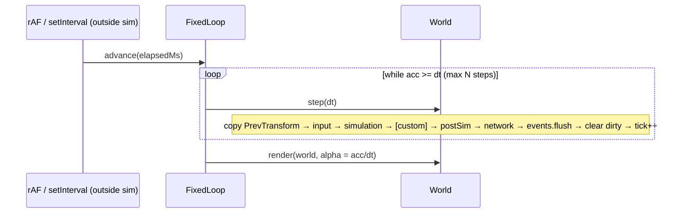
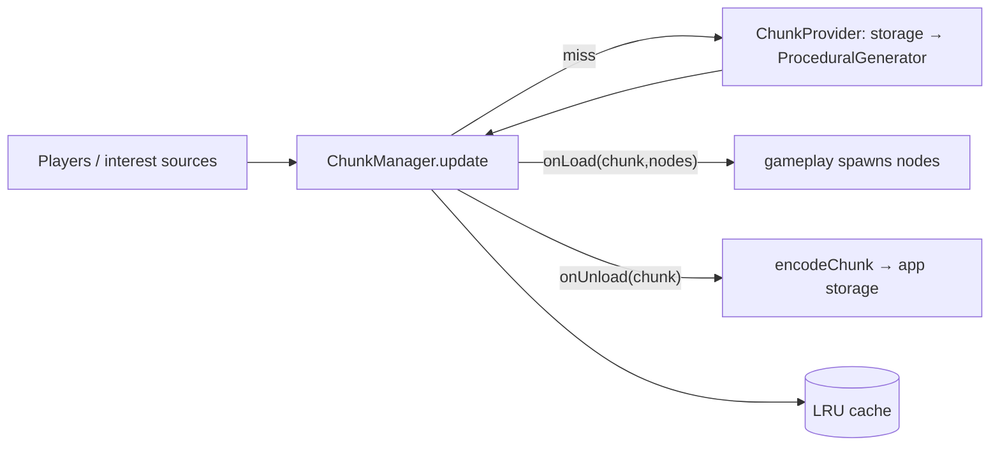
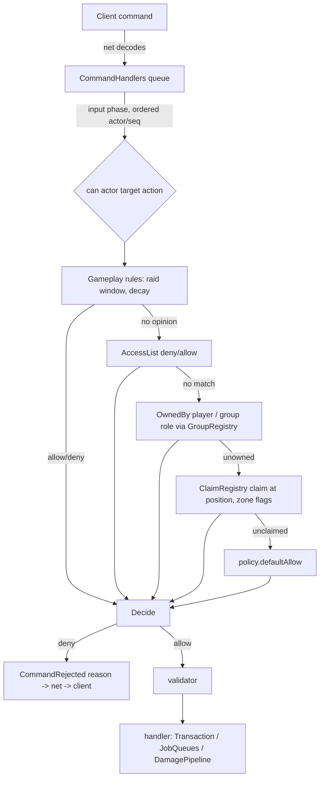

# Engine Architecture

2.5D isometric, multiplayer co-op survival engine (gathering, building, combat, day/night, weather). Browser first; cross-platform later.
Status: v0 skeleton. See `DECISIONS.md` for the ADR log. Netcode detail: `packages/net/ARCHITECTURE.md`.

## 1. High-level

```mermaid
flowchart LR
  subgraph Client [apps/client - browser, Vite]
    CI[Input devices] --> IS[InputState]
    IS --> CS[World sim - predicted]
    CS --> RP[renderPrep] --> R[@engine/render WebGL2]
    CN[@engine/net client] <--> CS
  end
  subgraph Server [apps/server - Node headless]
    SN[@engine/net server] <--> SS[World sim - authoritative]
  end
  CN <-- WebSocket binary / later WebTransport --> SN
  CS -.same packages.- SS
```

```mermaid
flowchart TB
  core[@engine/core\nECS, loop, math, events, schema, serialization, rng, input, assets]
  world[@engine/world\nchunks, tiles, iso coords, spatial hash]
  render[@engine/render\nstub - Renderer team]
  net[@engine/net\nstub - Netcode team]
  gameplay[@engine/gameplay\nstub - Survival Systems team]
  client[apps/client] --> render & net & gameplay & world & core
  server[apps/server] --> net & gameplay & world & core
  render --> world & core
  gameplay --> world & core
  net --> core
  world --> core
```

Rule: **dependencies point toward core**. `core`/`world`/`gameplay` must not touch DOM, WebGL, sockets or wall clock, so they run unchanged in Node.

## 2. Tech stack

| Choice | Rationale |
|---|---|
| TypeScript strict (+`noUncheckedIndexedAccess`, `exactOptionalPropertyTypes`) | One language for client + server sim; strictness catches the typed-array index bugs ECS code is prone to. |
| pnpm workspaces | Fast, strict dependency isolation (no phantom deps), `workspace:*` links. |
| Source-first packages (`main: src/index.ts`) | No per-package build step in dev; Vite, Vitest and tsx consume TS directly. `build` = typecheck; bundling only in apps. |
| Vite (client) | Instant HMR, native TS/ESM, good WebGL/asset story. |
| Vitest | Same transform pipeline as Vite, fast, Jest-compatible API. |
| Node 20 + tsx (server) | Runs the identical sim packages headless. |
| WebGL2 thin custom layer | Wide browser support, sprite batching control for iso depth sorting; WebGPU can be added behind `Renderer`. |

## 3. Package ownership

| Package | Owner | Status |
|---|---|---|
| `packages/core` | Engine/Architecture | Implemented |
| `packages/world` | Engine/Architecture | Implemented |
| `packages/render` | 2.5D Renderer team | Interfaces + `NullRenderer` |
| `packages/net` | Netcode team | Interfaces + message schemas; design in its ARCHITECTURE.md |
| `packages/assets` | Engine/Architecture (format), Art/Renderer (content) | Manifest loader, registry, placeholder art |
| `packages/testkit` | Engine/Architecture | Headless multi-client harness |
| `packages/gameplay` | Survival Systems team | Stub (Health, ResourceNode, day/night system) |
| `apps/client`, `apps/server` | Engine (shared) | Bootstraps |

Cross-team changes to `core` public API go through an ADR.

## 4. ECS design

- **Entity** = `uint32`: low 20 bits index (≤1,048,576), high 12 bits generation. Stale handles fail `isAlive`. Indices recycled via free list. Local entity ids are never sent on the wire (use `NetId`).
- **Components** = plain numeric data declared with a schema: `defineComponent(name, { x: "f32", hp: { type: "u16", quant: {bits, min, max} } }, { networked: true })`. No strings, objects or references; ids are numeric (tile ids, item ids, enum values).
- **Storage**: one sparse-set per component: `sparse: Int32Array[maxEntities]` → dense slot; SoA typed arrays per field (`store.data.x[slot]`); swap-remove. No archetypes → O(1) add/remove, no table migration.
- **Component ids** = registration order on the `World`. Built-ins register first: `NetId=0, Owner=1, Transform=2, PrevTransform=3`; gameplay registers next via one shared module on client and server. `world.getSchemaHash()` (FNV-1a over id, name, networked flag, field signature incl. quant hints) is checked at handshake and in snapshots.
- **Built-ins**: `NetId {id:u32}`, `Owner {clientId:u16}` (networked); `Transform {x,y,z,facing:f32}` in float tile units (networked, persistent; wire quantization z q10 [0,64], facing q8 [-π,π] — keep facing normalized); `PrevTransform` (local) copied from Transform at the **start** of each tick for interpolation.
- **Queries**: `world.query(all, none?)` iterates from the smallest store; iteration runs backwards so destroying the current entity is safe. Hot systems may read `store.data` arrays directly.
- **Change tracking**: each store has a per-entity dirty bitset set by `add`, `set`, `setField`, `store.write` and explicit `store.markChanged(i)` (required after raw typed-array writes). `world.changed(def)` iterates; cleared at end of `step()`.
- **Removal tracking**: each store records entities (with generation at removal) that lost the component this tick via `remove`/`destroy`; `world.removed(def)`. Same-tick re-add shows in both `removed` and `changed`. Cleared with dirty bits; untouched by `simulate()`.
- **Array fields & defaults**: `{type, length}` (stride-n SoA, `getArray/getElement/setElement`) and `{type, default}` (applied on add). Both are in the schema hash.
- **Environment**: `world.environment` singleton (NetId=ENV_NET_ID=1) with networked `TimeOfDay {dayLengthTicks, epochTick}` and `Weather {kind, intensity, endsAtTick}` (kind = gameplay u8 id). Neither changes per tick: read time with `timeOfDay(world)` (hours 0-24, day, derived from `world.tick`), jump with `setTimeOfDay`/`setDayLength`; weather lasts while `tick < endsAtTick`.
- **RNG streams**: `world.rngFor(key, netIdOrEntity?)` deterministic per (seed, tick, key, entity) for predictable outcomes; `world.rng` stays for authority-only rolls.
- **Input**: `defineActions` bit masks + schema commands (`defineCommand`, `CommandRegistry`, `encodeInputFrame`).
- **Spatial index**: `installSpatialIndex(world)` (world pkg) → postSim system `spatialIndex`, resource `SpatialIndexRes`.
- **Hooks**: `onSpawn`, `onDespawn` (despawn fires before components are removed).
- **Resources**: typed global singletons (`TimeOfDay`, `Weather`, ...) via `defineResource<T>(name)` + `world.setResource/resource`.
- **Events**: `EventBus` queued per tick (`emit` → delivered at `flush` at end of tick, deterministic order) plus `emitNow`.

## 5. Loop design



- Default **20 Hz** (`DEFAULT_TICK_HZ`), configurable. Accumulator with spiral-of-death clamp (`maxStepsPerFrame`, backlog dropped).
- Time is **injected**: only apps read `performance.now()`. Sim uses `world.tick`, `dt`, and `world.rng` (mulberry32, single u32 state → snapshot-able). No `Date.now`/`Math.random` in sim packages.
- Phases: `input, simulation, postSim, network, renderPrep`; custom phases via `addPhase(name, {after})`. `renderPrep` runs only on client per frame.
- `world.simulate(n, dt, {systems, beforeTick, startTick, keepEvents})` replays only the simulation phase (optionally named systems) with `world.tick` set per replayed tick and `isReplaying` true; events discarded by default; `world.predicted` marks predicted entities. `world.systemOrder()` lists order.

## 6. Data & serialization rules (networking)

1. Wire data comes only from component schemas / message schemas. Little-endian. Fields encoded in **sorted name order** (declaration order irrelevant).
2. Only `networked: true` components replicate. Sim-local components (PrevTransform, caches) never do.
3. Quantization is **wire-only**: `quant {bits,min,max}` hints live on the schema; `wireValue/quantize/dequantize` are used by net when sending. Sim state keeps full precision.
4. Per-field codecs `encodeField/decodeField(store, field, slot, FieldWriter|FieldReader)` — net wraps a bit writer around them.
5. Every blob is versioned: snapshot header `magic, version, tick, worldSchemaHash`; per component `id, schemaHash`. Decoders reject newer versions and hash mismatches. Schema changes ⇒ bump version / hash changes ⇒ clients must update.
6. Entity references across the wire use `NetId`, never local entity ids.
7. Inputs are serializable `InputFrame {tick, buttons bitfield, aim}`; the server applies them in the `input` phase.

## 7. World

- Chunks: 32×32 tiles, `Uint16Array` tile ids (0 = empty) + `Uint8Array` height, `dirty`/`version` for render & net streaming. `TileMap` stores chunks in a `Map<packedKey,Chunk>`, supports negative coords.
- Iso: 2:1 dimetric (64×32 px tiles, 16 px per z), `worldToScreen`, `screenToWorld(z)`, `screenToTile`, `isoDepth`.
- `SpatialHash` uniform grid (default 4 tiles) for broad-phase proximity/interest.

**Height convention (iso):** 1 terrain level = `zStep` = 16 px; 1 building floor = `FLOOR_HEIGHT_LEVELS` = 3 terrain levels (walls are 48 px tall; roofs of floor f sit at terrain level (f+1)·3 above the base). `Transform.z` is in terrain levels; `BuildingGrid` z is a floor index — convert with `floorToTerrainZ(floor, baseZ)` / `terrainZToFloor(z, baseZ)`.

## 8. Coding conventions

- Strict TS, ESM only, `.js` suffix in relative imports, `import type` for types (`verbatimModuleSyntax`).
- Sim packages: no DOM, no I/O, no wall clock, no `Math.random`; allocations avoided in per-entity hot loops.
- Components: numbers only; enums as `const enum` numeric; units are tile units / seconds / radians.
- Systems: `(world, dt) => void`, named, registered in phases; no hidden ordering.
- Tests: `packages/*/test/*.test.ts`, Vitest; each package's public behaviour tested. `pnpm test`, `pnpm -r build` (typecheck + client bundle) must pass before merge.
- Public API changes in core ⇒ ADR in `docs/DECISIONS.md`.

## 9. Open questions

1. Entity limit per world (default 65,536; max 2^20) and memory per store (`sparse` is `Int32Array[maxEntities]` per component) — move to paged sparse arrays if component count grows?
2. Floating-point determinism across browsers/Node: rely on reconciliation, or move sim to fixed-point for lockstep features?
3. Change tracking granularity: per-component bits (arrays included); per-field/element bits requested by gameplay E1/net N8 — still open.
4. ~~Removed-component tracking for delta replication~~ — resolved by ADR-023 (`world.removed(def)`). Remaining: does net need removal history beyond one tick (it must accumulate per-client between acks itself)?
5. ~~Chunk streaming/persistence format~~ — ADR-034/035. Open: storage backend, save-game index, async providers (worker generation).
6. Renderer in a Worker with OffscreenCanvas?
7. WebTransport timing and unreliable channel semantics.
8. Scripting/modding layer, and asset pipeline (atlas packing, hot reload).

## 10. World Streaming

- **Coordinates**: chunks are 32×32 tiles with signed int32 chunk coords; `ChunkKey = "cx,cy"`; helpers `chunkKey`, `parseChunkKey`, `chunkOf(pos)`, `chunkKeyOf(x,y)`.
- **ChunkManager** (extends `TileMap`): interest sources (`setSource({id,x,y,radius?})`) → active set (Chebyshev radius `loadRadius`), `unloadMargin` hysteresis, `maxLoadsPerUpdate` streaming budget, LRU (`cacheSize`) of inactive chunks. Hooks (stable names): `onLoad(chunk, nodes)`, `onUnload(chunk)`.
- **Providers**: `ChunkProvider.load(cx,cy)` returns `{chunk, nodes}`; `ProceduralGenerator({seed})` is the seeded stub (value-noise biomes + resource-node placements → gameplay spawns ResourceNodes in `onLoad`). A storage-backed provider decodes saved bytes first and falls back to the generator.
- **Persistence**: components flagged `persistent` are saved with their chunk via `encodeChunk(chunk, {world, entities, buildings})` / `decodeChunk(bytes, {world, buildings})` (versioned, RLE tiles, schema-hash checked, chunk-relative positions). No storage backend in engine packages.
- **Membership**: `ChunkMembership` (postSim) keeps entity→chunk; used by interest and per-chunk save.
- **Float precision**: f32 tile units are exact to 1/256 tile within ±65,536 tiles (`F32_SAFE_TILE_RANGE`). Beyond that use `WorldOrigin` rebasing (server regions, client camera) and chunk-relative storage. Never store absolute positions in f32 outside that range.



## 11. Interest Management

- `InterestGrid(membership, {radius, hysteresis})`; `setClientViewpoints(id, [{x, y, r?}])` (relevant set = union of viewpoints) or the shorthand `setClient(id, x, y, radius?)`, `setAlwaysRelevant(id, entities)`, `update()`, `get(id)` → `{chunks, entities, enteredChunks, leftChunks, entered, left}`.
- Cost per tick: O(clients × (2r+1)²) chunk checks + O(nearby entities); membership updates are O(moved entities).
- Benchmark (in `packages/world/test/interest.test.ts`, box CPU): 200 players, 50k entities over 64×64 chunks, r=2: initial membership 50k ≈ 20 ms, first interest update ≈ 14 ms, steady tick (2.5k moved entities + interest for 200 players) ≈ 8 ms, ~300 relevant entities/player.
- Netcode consumes enter/leave for spawn/despawn replication and budget prioritisation.

## 12. Building Grid

- `BuildPieceDef` (data, `loadBuildPieces(raw, {lock, resolveResource})`): `footprint {w,h}`, `levels`, `layer` (0 floor, 1 structure, 2 furniture, 3 decor), `solid`, `cost [{resource, amount}]`, `sockets [{x,y,z?,kind}]` in 1/4-tile units, `hp`, optional sprite.
- `BuildingGrid`: per-chunk `StructureLayer` (sparse occupancy by level 0..15 × layer × tile; anchored instance set for persistence). `canPlace`, `place`, `remove`, `at`, `isBlocked`, `queryRect`, rotation 0..3, footprints may cross chunk borders.
- Graph hooks: `supportsOf`, `dependentsOf`, `neighborsOf`, `stabilityRule` + `unstable()`. Sockets: `socketsOf`, `snap(sx, sy, z, {kind, maxDist})`.
- Engine supplies structures and queries only; costs, permissions, decay, stability/collapse rules are Survival Systems'.
- Open: thin edge walls (between tiles) are modelled as sockets/layer 1 for now.

**Floors and states:** building z = floor index (1 floor = 3 terrain levels, see §7). Pieces carry a u8 `state` (0..63; e.g. door closed/open) changed only via `setState`, which records a `State` building change; it is persisted in the upper bits of the chunk codec rot byte (format v1 unchanged). Layers follow the art table in `/workspace/assets/INTEGRATION.md` (0 floor, 1 structure incl. walls/pillars/roofs/fences, 2 furniture, 3 decor).


## 13. Asset Pipeline

- `@engine/assets`: manifest v1 JSON. `loadManifest(json, {lock})` validates everything (all issues reported in one `ManifestError`) and assigns stable u16 ids per namespace (`sprites, sounds, vfx, variants, tints, palettes`) via `StableIdRegistry` + `ids.lock.json` (`pnpm --filter @engine/assets lock:ids` keeps existing ids and appends new keys; legacy flat sprite locks are migrated). `AssetRegistry.hash` covers all namespaces; `installAssetHash(world, reg)` adds it to the handshake schema hash.
- Resolution: `frame(spriteId, anim, facing, t)`, `buildingFrame(spriteId, rotation, damageStage)` → atlas rect, pivot, optional `emissiveImage` and `nineSlice`; `sound(key)`, `effect(key)`, `variant(key)`, `variantsOf(set)`, `palette(key)`, `tintSet(key)`.
- `validateBuildingSprites(reg, pieces)` cross-checks building sprites against `BuildPieceDef`s (piece exists, footprint, layer).
- Placeholder art: `pnpm --filter @engine/assets gen:placeholders` (cute outlined shapes, emissive page for buildings, UI panel/button, vfx). Sound files are referenced but not shipped.
- Renderer owns texture upload/batching, palette swap shaders and particles; audio owner plays `SoundDef`s; gameplay maps item/resource/piece ids to keys.

Atlases (grid frames; optional emissive page `<image>_emissive.png` with identical layout; UI nine-slice insets per frame):
```json
{ "key": "buildings", "image": "buildings.png", "frameW": 64, "frameH": 64, "columns": 4, "rows": 4, "emissive": true }
{ "key": "ui", "image": "ui.png", "frameW": 32, "frameH": 32, "columns": 2, "rows": 1, "nineSlice": { "0": { "l": 6, "t": 6, "r": 6, "b": 6 } } }
```
Sprites (category character|zombie|item|equipment|resource|building|tile|ui|vfx; animations with 1/4/8 iso directions):
```json
{ "key": "player", "category": "character", "atlas": "characters", "anchor": { "x": 0.5, "y": 0.92 },
  "animations": { "idle": { "frames": [0, 1], "fps": 3, "directions": 8 }, "walk": { "frames": [2, 3], "fps": 8, "directions": 8 } } }
```
Building piece sprites (`frames[rotation][damageStage]`, 1 or 4 rotations × 4 stages; checked against BuildPieceDef):
```json
{ "key": "wall", "category": "building", "atlas": "buildings", "animations": { "idle": { "frames": [1], "fps": 1 } },
  "building": { "piece": "wall", "footprint": { "w": 2, "h": 1 }, "layer": 1, "frames": [[1, 5, 9, 13]] } }
```
Sounds (random file variants):
```json
{ "key": "sfx_chop", "files": ["sfx/chop_1.ogg", "sfx/chop_2.ogg"], "volume": 0.8, "pitchJitter": 0.1, "loop": false, "category": "sfx" }
```
VFX (sprite animation + particles; blend normal|additive|multiply):
```json
{ "key": "campfire_sparks", "sprite": "fx_spark", "anim": "idle", "lifetime": 1.2, "blend": "additive",
  "particles": { "rate": 12, "count": 0, "speed": [0.5, 1.5], "spread": 0.6, "gravity": -0.5, "fade": true, "scaleCurve": [1, 0.6, 0] } }
```
Tint sets, palette swaps and variant sets (player/zombie variants by tint, palette or alternate sprite):
```json
{ "key": "shirt_colors", "tints": ["#ff6b6b", "#ffd93d", "#4d96ff"] }
{ "key": "zombie_pale", "source": ["#78aa5a", "#96d278"], "target": ["#9aa0a8", "#c8ccd2"] }
{ "key": "zombie_variants", "base": "zombie_walker",
  "variants": [{ "key": "zombie_green" }, { "key": "zombie_pale", "palette": "zombie_pale" }, { "key": "zombie_red", "tint": "shirt_colors", "tintIndex": 0 }] }
```

**Default content vs fixture (batch 9):** the real art pack in `packages/assets/pack/` is the default manifest (`DEFAULT_MANIFEST`, `fetchDefaultManifest(base)`, Node: `@engine/assets/node` `loadDefaultManifest()`); `packages/assets/sample/` is the placeholder **test fixture** (`FIXTURE_MANIFEST`, `loadFixtureManifest()`), and placeholder-specific assertions live in `test/fixture.test.ts`. Lock scripts: `pnpm --filter @engine/assets lock:ids` (fixture) and `lock:ids:pack`.

Typed schema additions (validated):

```json
{ "key": "critter_bunny", "category": "critter", "atlas": "critters", "animations": { "idle": { "frames": [0, 1], "fps": 4, "directions": 4 } } }
{ "key": "door", "category": "building", "atlas": "buildings", "rotationArt": "unique4", "animations": { "idle": { "frames": [8], "fps": 1 } },
  "building": { "piece": "door", "footprint": { "w": 2, "h": 1 }, "layer": 1,
    "frames": [[8,9,10,11],[12,13,14,15],[16,17,18,19],[20,21,22,23]],
    "states": { "closed": [[8,9,10,11],[12,13,14,15],[16,17,18,19],[20,21,22,23]], "open": [[24,25,26,27],[28,29,30,31],[32,33,34,35],[36,37,38,39]] } } }
{ "key": "fence", "category": "building", "rotationArt": "mirror", "building": { "frames": [[1,5,9,13],[2,6,10,14]] } }
{ "key": "tree", "category": "resource", "sway": { "amp": 2.0, "freq": 0.35, "stiffness": 0.6 } }
{ "key": "amb_rain", "files": ["audio/ambience/rain_loop.ogg"], "category": "ambience", "loop": { "start": 0.12, "end": 8.5 } }
```

- `critter` is an optional category (`OPTIONAL_CATEGORIES`; `CATEGORIES` = required set).
- `rotationArt`: `mirror` accepts 1 (symmetric), 2 (rotations 2/3 = rows 0/1 with `FrameRef.flipX`) or 4 rows; `unique4` requires 4.
- `building.states`: per-state `frames[rotation][damage]`; state index = declaration order = BuildingGrid `state`; `buildingFrame(id, rot, dmg, state)`, `stateIndex(id, name)`.
- `sway {amp px, freq Hz, stiffness 0..1}` → `SpriteDef.sway`. Sound `loop: true | {start, end}` (seconds) → `SoundDef.loop` + `loopPoints`.

## 14. Testing

- Unit: Vitest per package (`packages/*/test`). Headless helpers in core: `createTestWorld`, `stepN`, `FakeClock`, `TEST_SEED`.
- Multi-client: `@engine/testkit` `createHarness({clients, makeWorld, applyInput, onClientJoin, link})` → in-process server + N clients over loopback; `h.tick(n)` advances clock, network, server and clients deterministically.
- Benchmarks live as tests that log `[bench]` lines and assert generous ceilings.
- `pnpm check` (typecheck + tests) must pass after every change; CI: `.github/workflows/ci.yml`.

## 15. Environment & Survival Support

Engine packages provide mechanisms; Survival Systems (gameplay) owns all rules, numbers and stat/kind ids.

| Need | Mechanism | Where |
|---|---|---|
| Heat sources, light-as-warmth, smell/noise fields | `Emitter` component + `installEmitterIndex(world, {occlusion})` → `sampleField(kind, x, y, z?)`, `nearestEmitters(kind, x, y, n)`; `buildingOcclusion(grid)` lets walls block | world |
| Shelter, rooms, rain/wind exposure | `BuildingGrid.isCovered`, `.enclosure` (cached flood fill), `.exposure(x, y, z, windDir)` | world |
| Wind | `Weather.windDir` (q8), `Weather.windSpeed` (q8) on `world.environment` | core |
| Temperature/humidity/altitude | `installClimate(world, generator, model?)`, `climateAt(world, x, y)`; gameplay registers a `ClimateModel` (curves for time of day and weather) | world |
| Slow systems (decay, environment) | `addSystem(phase, name, fn, {every, offset})`; dt passed is `dt × every`; staggered by name hash | core |
| Food decay in inventories | `decayAt(createdTick, rate, tick)` / `decayReachesAt` — store `createdTick` (or `lastUpdateTick` + value) per slot; never tick per item | core |
| Buffs/debuffs (wet, cold, well-fed) | `defineModifierStack(name, cap)`, `addModifier`, `evaluate(world, e, def, stat, base)`, `pruneModifiers` | core |

Guidance:
- Run environment/exposure at 4–5 Hz (`every: 4`) and decay pruning at ≤1 Hz; integrate with the passed dt.
- Prefer absolute ticks (`expiresAtTick`, `endsAtTick`, `createdTick`) over countdown fields: they replicate once and replay correctly.
- Register `Emitter` and modifier stacks in the shared registration module so component ids match on all peers.
- Benchmark (`packages/world/test/environment.test.ts`, box CPU): 2k emitters index build ≈ 17 ms; `sampleField` for 200 players ≈ 0.44 ms per tick (≈ 2 µs per sample).

## 16. Social, Permissions, Combat & Crafting Support

Core provides mechanisms; gameplay owns rules (roles, raid windows, damage math, recipes); net owns transport, persistence wiring and lag compensation.



| Area | Core/world API | Owner of rules |
|---|---|---|
| Identity | `PlayerId` (persistent) vs `Owner.clientId` (transient) | net maps accounts → PlayerId |
| Groups | `GroupRegistry` (encode/decode, `changesSince`), `Membership`, `OwnedBy` | gameplay (invites, roles), net (sync, save) |
| Permissions | `definePermissionActions`, `can`, `canAt`, `AccessList`, `addPermissionRule`, `ClaimRegistry`, `zoneAt` | gameplay |
| Combat | `DamagePipeline` (`pre`/`mitigation`/`post`), `canDamage`, `DamageApplied` | gameplay; lag comp = `@engine/net` `PositionHistory.getPositionAt`, `rangeCheckWithSlack` |
| Items | `SlotContainer` adapters over gameplay Inventory, `transfer`, `Transaction`/`transaction` | gameplay |
| Crafting | `Scheduler`, `defineJobQueue` + `JobQueues`, `@engine/assets` `loadRecipes` | gameplay (station range, consumption, refunds) |
| Chat | `ChannelRegistry`, `TokenBucket`, `MuteList`, `encodeChatMessage`, `writeString` | net (transport) |
| Commands | `installCommandHandlers`, `CommandRejected` | gameplay handlers, net delivery |

## 17. Persistence, Change Records & Testing/Demo

**Persistence** is owned by Netcode: see [`packages/persist/README.md`](../packages/persist/README.md) (WorldStore backends, autosave, player save/restore). Engine-side contracts it builds on: `encodeChunk`/`decodeChunk` (format v1), `persistent` component flag, `ChunkManager.onLoad/onUnload`, sync `ChunkProvider` (async variant: `AsyncChunkProvider`, ADR-061).

| Package | Owner | Role |
|---|---|---|
| packages/persist | Netcode | storage backends, autosave, sessions |

**Change records for net** (drain once per tick in the network phase):
- `chunkManager.tileChanges()` → `{key, version, changes: (index, old, new)…}`; wire via `encodeTileDelta` / `applyTileDelta`.
- `buildingGrid.buildingChanges()` → `Placed | Removed | Hp` records; mutate hp only via `setHp`/`damage`.
- ECS: `world.changed(def)` / `world.removed(def)`; `setField`/`setElement`/`set` always mark dirty.

**Testing & Demo** (root scripts):
- `pnpm check` — typecheck + all tests (CI gate).
- `pnpm bench` — benchmarks with strict timing asserts (`PERF=1`).
- `pnpm test:net` — multiplayer/network test suite.
- `pnpm demo` — persistent server + Vite client (open the printed URL; reload = same player).
- `pnpm demo:bots` — demo server with headless WebSocket bots.

